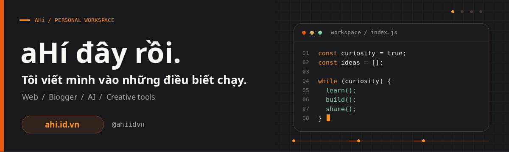
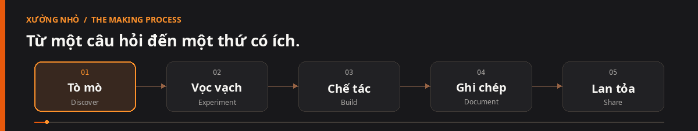

<!-- aHi | Personal GitHub profile | Local, self-contained visual assets -->

<div align="center">
  <a href="https://ahi.id.vn"></a>
  <br />
  <strong>Chia sẻ điều tôi biết · Xây dựng điều tôi thích.</strong>
  <br /><br />
  <a href="https://ahi.id.vn">Website</a> &nbsp;·&nbsp;
  <a href="https://github.com/ahiidvn/ahiLib">ahiLib</a> &nbsp;·&nbsp;
  <a href="https://github.com/ahiidvn?tab=repositories">Repositories</a> &nbsp;·&nbsp;
  <a href="https://github.com/ahiidvn?tab=overview">GitHub Activity</a>
</div>

---

## Xin chào, mình là aHí

**Một người thích viết, thích vọc công nghệ và thích tự tay tạo ra những thứ mình cần.**

[ahi.id.vn](https://ahi.id.vn) là góc riêng để mình lưu lại những điều đã học, chia sẻ những cách làm hữu ích và thử nghiệm các ý tưởng trong thế giới số. Từ một đoạn code, một giao diện Blogger đến một công cụ nhỏ hay một bài viết về AI, mình thích quá trình biến sự tò mò thành thứ có thể sử dụng được.

Không nhất thiết phải làm một điều thật lớn. Một công cụ tiết kiệm vài phút mỗi ngày, một dòng code dễ hiểu hơn hoặc một bài viết giúp ai đó giải quyết vấn đề cũng đáng để làm kỹ.

```javascript
const aHi = {
  website: 'https://ahi.id.vn',
  interests: ['Web', 'Blogger', 'AI', 'Useful tools'],
  approach: ['Learn', 'Build', 'Share'],
  mindset: 'Make things useful. Keep things simple.'
};
```

## Những điều mình đang làm

| Lĩnh vực | Hướng phát triển |
| :--- | :--- |
| **Website & Blogger** | Thiết kế giao diện, phát triển template XML, cải thiện trải nghiệm đọc, SEO và hiệu năng. |
| **Ứng dụng & Lập trình** | Xây dựng công cụ web, xử lý dữ liệu và tự động hóa những thao tác lặp lại. |
| **AI & Prompt Engineering** | Thử nghiệm prompt có cấu trúc, quy trình làm việc với AI và các công cụ hỗ trợ lập trình. |
| **Xưởng nhỏ** | Biến những ý tưởng thiết thực thành tiện ích có thể chạy trực tiếp trên trình duyệt. |
| **Góc nhìn của aHí** | Viết về công nghệ, trải nghiệm làm việc và những thay đổi đáng chú ý trong cuộc sống số. |

## Công nghệ & kỹ năng

<div align="left">
  
  
  
  
  
  
  
  
</div>

| Năng lực & mối quan tâm | Công nghệ / thực hành |
| :--- | :--- |
| **Web development** | HTML, CSS, JavaScript, responsive design, browser APIs |
| **Blogger customization** | XML templates, widgets, theme customization, technical SEO |
| **Programming & data** | SQL, Python, PHP, data processing and automation |
| **Creative development** | UI design, prototyping, client-side utilities |
| **AI-assisted development** | Prompt engineering, code assistance, validation and iteration |
| **Developer workflow** | Git, GitHub, documentation and reusable components |

## Xưởng nhỏ — Project shelf

Những repository và hướng thử nghiệm mình dành thời gian chăm chút.

<table>
  <tr>
    <td width="50%" valign="top">
      <h3><a href="https://github.com/ahiidvn/ahiLib">ahiLib</a></h3>
      Thư viện aHí cho các sản phẩm online. Nơi tập hợp những tài nguyên và thành phần dùng lại cho các công cụ, thử nghiệm web.
      <p><sub>LIBRARY · REUSABLE RESOURCES</sub></p>
    </td>
    <td width="50%" valign="top">
      <h3><a href="https://ahi.id.vn">aHí đây rồi</a></h3>
      Không gian cá nhân dành cho kiến thức, Blogger, AI, các công cụ và những góc nhìn về công nghệ.
      <p><sub>WEBSITE · DIGITAL NOTEBOOK</sub></p>
    </td>
  </tr>
  <tr>
    <td width="50%" valign="top">
      <h3>Web Tools</h3>
      Hướng phát triển các tiện ích chạy trên trình duyệt: xử lý tài liệu, hình ảnh, dữ liệu và những tác vụ thường ngày.
      <p><sub>PROJECT DIRECTION · BROWSER-FIRST</sub></p>
    </td>
    <td width="50%" valign="top">
      <h3>Prompt AI Studio</h3>
      Ý tưởng về một không gian xây dựng, tổ chức và cải tiến prompt theo cách có hệ thống.
      <p><sub>PROJECT DIRECTION · AI &amp; PRODUCTIVITY</sub></p>
    </td>
  </tr>
</table>

<a href="https://github.com/ahiidvn?tab=repositories">Khám phá toàn bộ repositories →</a>

## Nhịp làm việc tại Xưởng nhỏ

<div align="center">
  
</div>

- Bắt đầu từ một vấn đề thật, thay vì bắt đầu từ một công nghệ đang thịnh hành.
- Thử nghiệm sớm, giữ lại điều hữu ích và sẵn sàng bỏ những thứ rườm rà.
- Ưu tiên giao diện dễ hiểu, mã nguồn dễ đọc và trải nghiệm đủ tốt để sử dụng mỗi ngày.
- Tận dụng AI để mở rộng khả năng sáng tạo, nhưng luôn kiểm tra lại kết quả.
- Ghi chép và chia sẻ những điều đã học để lần sau không phải bắt đầu lại từ đầu.

## Những điều muốn trao đổi

Mình luôn thích những cuộc trò chuyện về cách thiết kế một website tốt hơn, làm một công cụ hữu ích hơn, viết prompt rõ ràng hơn hoặc đơn giản hóa một vấn đề kỹ thuật. Nếu một repository có phần Issues được mở, bạn có thể gửi góp ý tại đó.

## Dấu chân trên GitHub

Theo dõi các [repository công khai](https://github.com/ahiidvn?tab=repositories) và [hoạt động đóng góp](https://github.com/ahiidvn?tab=overview) của mình trực tiếp trên GitHub. Đây cũng là nơi lưu lại những thử nghiệm, bản nháp và các bước tiến nhỏ theo thời gian.

---

<div align="center">
  <h3>Viết điều có ích. Làm thứ có giá trị.</h3>
  <p><em>Tôi viết mình vào những điều biết chạy.</em></p>
  <p><a href="https://ahi.id.vn"><strong>ahi.id.vn</strong></a> &nbsp;·&nbsp; <a href="https://github.com/ahiidvn">@ahiidvn</a></p>
  <sub>Made with curiosity, care &amp; a little bit of code.</sub>
</div>
